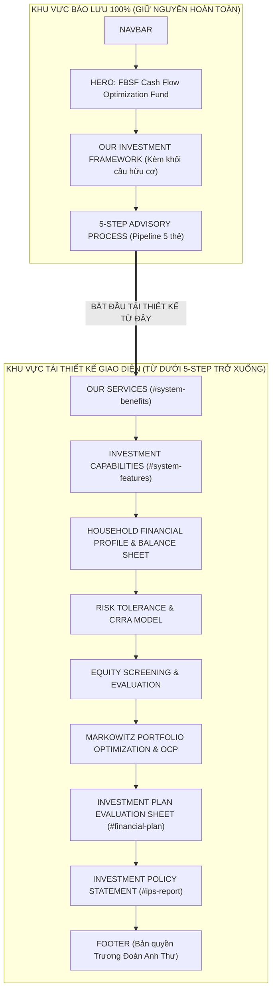

# KẾ HOẠCH TRIỂN KHAI THIẾT KẾ GIAO DIỆN HỆ THỐNG (CHUẨN HÓA TITLE & TÁCH GỘP)
## FBSF CASH FLOW OPTIMIZATION FUND — FIDUCIARY PRIVATE WEALTH PLATFORM
**Vai trò kiến trúc:** Principal Design Systems Architect (Stripe & Sequoia Capital Standards)  
**Tài liệu tham chiếu:** [FIGMA_MAKE_PROMPT.md](file:///d:/MY-PROJECT/smart-portfolio-landing-page/FIGMA_MAKE_PROMPT.md) | [PORTFOLIO_LANDING_PAGE_SPECIFICATION.md](file:///d:/MY-PROJECT/smart-portfolio-landing-page/PORTFOLIO_LANDING_PAGE_SPECIFICATION.md)

---

## 1. NGUYÊN TẮC BẤT BIẾN & RANH GIỚI TRIỂN KHAI

### 1.1. Các thay đổi cốt lõi theo phản hồi người dùng:
1. **Bảo lưu tuyệt đối Section `5-STEP ADVISORY PROCESS`:** Giữ nguyên 100% giao diện pipeline 5 thẻ có sẵn trong [AdvisoryProcess.tsx](file:///d:/MY-PROJECT/smart-portfolio-landing-page/src/features/workflow/components/AdvisoryProcess.tsx) (ảnh full-bleed, badge số thứ tự và đường connector).
2. **Loại bỏ hoàn toàn Trục dọc (Vertical Data Spine):** Không vẽ đường kẻ hairline dọc lề trái chạy qua các section, tránh gây rối mắt và chia cắt giao diện.
3. **Loại bỏ hoàn toàn Mũi tên dẫn hướng (Micro Flow Connectors):** Không dùng các đường nối cong bezier hay icon mũi tên nhân tạo giữa các section.
4. **Cơ chế liên kết xuyên suốt tự nhiên:**
   - **Bảng màu định chế nhất quán:** Alabaster `#F8FAF9`, Pure White `#FFFFFF`, Deep Forest `#062C1E`, Pine Green `#0B4630`, Tactile Hairline `1px solid #E2ECE7`.
   - **Lưới tọa độ kiến trúc ngầm (Architectural Grid 64x64px):** Chạy ngầm dịu mắt đồng bộ toàn trang.
   - **Thẻ chờm giao thoa (Section Overlap Cards 24px – 36px):** Phá vỡ triệt để cảm giác slide thuyết trình rời rạc.
5. **Chuẩn hóa Section Title:** Đọc và sử dụng chuẩn xác 100% các tiêu đề (Heading titles) hiện có trong mã nguồn ứng dụng.

---

## 2. ĐẶC TẢ CHI TIẾT TỪNG PHẦN RIÊNG BIỆT & ĐỀ XUẤT GỘP (SECTION SPECIFICATIONS)

---

### PHẦN 1: NAVBAR (THANH ĐIỀU HƯỚNG CỐ ĐỊNH) — [GIỮ NGUYÊN]
- **Title chuẩn:** `FBSF Fund Logo & Navigation Menu`
- **Tình trạng:** **BẢO LƯU GIỮ NGUYÊN 100%**
- **Đặc tả hiện hữu:** Sticky top 72px, kính mờ `rgba(255, 255, 255, 0.85)` + `backdrop-blur: 16px`, viền dưới 1px solid `#E2ECE7`, 6 liên kết điều hướng và nút CTA "Bắt đầu tư vấn ↗".

---

### PHẦN 2: HERO SECTION (`#hero`) — [GIỮ NGUYÊN]
- **Title chuẩn trong code:** **`FBSF Cash Flow Optimization Fund`** (Subtitle: *"A disciplined investment strategy balancing long-term growth, risk management, and financial stability"*)
- **Tình trạng:** **BẢO LƯU GIỮ NGUYÊN 100%**
- **Đặc tả hiện hữu:** Nền ảnh kiến trúc kết hợp gradient xanh ngọc, tiêu đề H1 phân tầng, 2 nút CTA kép và thanh chỉ số định chế 4 cột (Stats Ribbon Strip: 500+ Families, 15% Annual Return, 98% Satisfaction, 10 Years Experience).

---

### PHẦN 3: OUR INVESTMENT FRAMEWORK (`#system-workflow`) — [GIỮ NGUYÊN]
- **Title chuẩn trong code:** **`OUR INVESTMENT FRAMEWORK`** (Subtitle: *"FBSF evaluates each client’s financial profile, risk tolerance, investment objectives, and cash flow needs to construct a diversified and optimized portfolio"*)
- **Tình trạng:** **BẢO LƯU GIỮ NGUYÊN 100%**
- **Đặc tả hiện hữu:** Bố cục 2 cột (Cột trái: 3 thông điệp *"Analyze comprehensively. Optimize systematically. Invest with purpose."*; Cột phải: Khung ảnh khối cầu hữu cơ Organic Blob Sphere với viền cong `border-radius: 64% 36% 56% 44% / 46% 62% 38% 54%` và vầng sáng Emerald Aura mờ).

---

### PHẦN 4: 5-STEP ADVISORY PROCESS (`#system-process`) — [GIỮ NGUYÊN]
- **Title chuẩn trong code:** **`5-STEP ADVISORY PROCESS`** (Subtitle: *"From comprehensive financial profiling to institutional IPS delivery — a disciplined end-to-end framework."*)
- **Tình trạng:** **BẢO LƯU GIỮ NGUYÊN 100% THEO YÊU CẦU NGƯỜI DÙNG**
- **Đặc tả hiện hữu:** Dàn 5 thẻ pipeline tương ứng 5 bước tư vấn (`01 Financial Profiling`, `02 Risk Assessment`, `03 Equity Screening`, `04 Portfolio Optimization`, `05 IPS Report Delivery`). Ảnh full-bleed tràn viền trên, Floating Pill Badge và các node liên kết neo cuộn trang.

---

### PHẦN 5 & 6: OUR SERVICES & INVESTMENT CAPABILITIES — [GỘP THEO BỐ CỤC ASYMMETRIC BENTO]
- **Titles gốc trong code:** 
  * Phần 5: **`OUR SERVICES`** (Subtitle: *"Personalized Financial Planning & Investment Management"*) — `#system-benefits`
  * Phần 6: **`INVESTMENT CAPABILITIES`** (Subtitle: *"A disciplined framework for portfolio selection, risk management and optimization."*) — `#system-features`
- **Bố cục chính thức đã chọn: "Institutional Asymmetric Bento Matrix" (Tỷ lệ vàng 5 cột / 7 cột):**
  * **Phân vùng Trái (5/12 cột) — Hero Dark Card `OUR SERVICES`:**
    - Khung thẻ đơn khối màu **Deep Forest Primary `#062C1E`**, viền hairline 1px `rgba(255, 255, 255, 0.12)`, bo góc `border-radius: 20px`.
    - Đóng vai trò mỏ neo thị giác quyền uy, thể hiện 4 dịch vụ giá trị cốt lõi mang lại cho khách hàng:
      1. *01. Household Cash Flow Engineering:* Chẩn đoán rò rỉ cấu trúc, xóa thâm hụt và xây dựng thặng dư tự động.
      2. *02. Markowitz Mean-Variance Asset Allocation:* Thiết lập danh mục rủi ro tối ưu ORP phù hợp khẩu vị rủi ro.
      3. *03. Goal-Based Asset & Liability Matching:* Cân đối dòng tiền thực hiện các mục tiêu mua xe và mua nhà không lạm dụng đòn bẩy.
      4. *04. Governance & Performance Benchmarking:* Giám sát liên tục và đối sánh hiệu suất danh mục theo VN-Index.
    - Cấu trúc hiển thị: Danh sách hairline phân tầng (Vertical Hairline List) với icon hình học kỹ thuật tối giản, số thứ tự `01 – 04` font JetBrains Mono 12px màu Mint `#ECFDF5`.
  * **Phân vùng Phải (7/12 cột) — Bento Grid 2x2 `INVESTMENT CAPABILITIES`:**
    - Lưới 4 thẻ bề mặt **Pure White Surface `#FFFFFF`**, viền hairline 1px `#E2ECE7`, bo góc 16px, bóng đổ đa tầng tự nhiên `0 4px 20px -2px rgba(10, 22, 40, 0.04)`.
    - Thể hiện 4 năng lực công nghệ và thuật toán định lượng nền tảng:
      1. *01. Financial & Risk Assessment:* Đánh giá vị thế tài chính và khẩu vị rủi ro qua khung chuẩn hóa. Nhãn overline: `ANALYTICS ENGINE`.
      2. *02. Equity Screening & Analysis:* Sàng lọc cổ phiếu niêm yết theo tài chính, định giá và thanh khoản. Nhãn overline: `SCREENING PIPELINE`.
      3. *03. Portfolio Optimization:* Kết hợp phương pháp định lượng tối đa hóa Sharpe Ratio của danh mục ORP. Nhãn overline: `MPT OPTIMIZER`.
      4. *04. Optimal Complete Portfolio (OCP):* Tích hợp ORP với tài sản phi rủi ro theo khẩu vị khách hàng. Nhãn overline: `FIDUCIARY OCP` (Gắn nhãn highlight màu Emerald `#10B981`).
- **Ưu điểm kiến trúc & Thẩm mỹ đạt được:**
  - Tiết kiệm 50% chiều cao section so với 2 section trôi nổi cũ, người xem quan sát trọn vẹn 8 mục giá trị trong đúng 1 khung nhìn (viewport).
  - Phân định ranh giới tư duy rành mạch: Trái là *"Dịch vụ gia đình nhận được"* ⇄ Phải là *"Sức mạnh thuật toán thực thi"*.
  - Tạo thế tương phản thị giác độc bản giữa Deep Forest và Pure White, chuẩn ngôn ngữ thiết kế của Stripe & Morgan Stanley Wealth Management.

---

### PHẦN 7, 8, 9, 10: HOUSEHOLD FINANCIAL PROFILE & BALANCE SHEET — [GỘP THEO GỢI Ý 1: INSTITUTIONAL FIDUCIARY MEGA-BENTO (4 TẦNG LIỀN MẠCH)]
- **Title chuẩn trong code:** **`HOUSEHOLD FINANCIAL PROFILE & BALANCE SHEET`** (`#financial-profile`)
- **Subtitle:** *"Comprehensive audit of household demographics, life milestones, asset-liability balance, and monthly cash flow diagnostics."*
- **Quyết định kiến trúc chính thức:** **GỢI Ý 1 — INSTITUTIONAL FIDUCIARY MEGA-BENTO (4 TẦNG LIỀN MẠCH)**
  * Kế thừa ngôn ngữ thị giác từ bản mockup người dùng đã duyệt (phong cách tương phản Deep Forest ⇄ Pure White ⇄ Alabaster của Stripe Wealth / Sequoia Capital).
  * Khắc phục triệt để và **bổ sung đầy đủ 100% các dữ liệu gốc bị thiếu** trên bản mẫu (khoản phải thu 100 triệu, năm sinh, nơi làm việc/học tập, số tiền chi tiết VNĐ/tháng & năm của từng nhóm chi tiêu).
  * Xếp chồng 4 tầng dữ liệu logic liền khối, tạo thành một Fiduciary Dashboard chuẩn mực quốc tế:

#### CẤU TRÚC 4 TẦNG CHI TIẾT (WIRE-FRAME & DATA SCHEMA):
1. **TẦNG 1: DEEP FOREST DEMOGRAPHIC MATRIX (Nền tối Primary `#062C1E`, Bo góc 20px, Viền 1px hairline `rgba(255,255,255,0.1)`):**
   - **4 Thẻ thành viên đối xứng (4-Column Grid):**
     * **Anh Nam [AN]:** 41 tuổi (sinh 1985) · Chồng / Trụ cột chính · Trưởng phòng Kế toán · PGD Ngân hàng | Thu nhập: **`45.000.000 đ / tháng`** (`540.000.000 đ / năm`).
     * **Chị Nữ [NỮ]:** 36 tuổi (sinh 1990) · Vợ / Trụ cột phụ · Nhân viên Kế toán · PGD Ngân hàng | Thu nhập: **`20.000.000 đ / tháng`** (`240.000.000 đ / năm`).
     * **Bé lớn [12]:** 12 tuổi (sinh 2014) · Học sinh cấp 2 · Trường Tuệ Đức (Quận 2) | Tag: *Người phụ thuộc*.
     * **Bé nhỏ [05]:** 5 tuổi (sinh 2021) · Mẫu giáo · Trường Vườn Hồng (Quận 2) | Tag: *Người phụ thuộc*.
   - **Thanh Ticker Chân Thẻ (Family Context Strip):**
     * `FAMILY CONTEXT`: Đang thuê nhà tại Lương Đình Của, Quận 2 (20 tr/tháng) · Đã có BHXH, BHYT (Chưa có BHNT) · Bố mẹ hai bên có lương hưu tự chủ tài chính.
   - **Badge Tổng thu nhập gia đình (Nổi bật góc trên/chân thẻ):**
     * Tổng thu nhập: **`65.000.000 đ / tháng`** (`780.000.000 đ / năm`).

2. **TẦNG 2: STRATEGIC FINANCIAL GOALS (Pure White Surface `#FFFFFF`, Bo góc 16px, Viền 1px `#E2ECE7`, 2 Cột 50/50):**
   - **Cột Trái — Mục tiêu 1 [TRUNG HẠN — 03 NĂM TỚI]:**
     * Tiêu đề: **Mua xe hơi**
     * Mô tả: Phục vụ di chuyển an toàn & thuận tiện đưa đón các con đi học.
     * Số tiền mục tiêu: **`800.000.000 đ`** (Font JetBrains Mono 28px Bold).
     * Thanh tiến độ Fiduciary: **`37.5% tiến độ hiện tại`** (cơ sở: 300 triệu tiền mặt / 800 triệu mục tiêu).
   - **Cột Phải — Mục tiêu 2 [DÀI HẠN — 10 NĂM TỚI]:**
     * Tiêu đề: **Mua nhà đất an cư**
     * Mô tả: Nhà phố 60m² tại đường Lê Văn Việt, TP. Thủ Đức (Quận 9 cũ) để ổn định chỗ ở lâu dài.
     * Số tiền mục tiêu: **`3.400.000.000 đ`** (Font JetBrains Mono 28px Bold).
     * Thanh tiến độ Fiduciary: **`27.9% tiến độ hiện tại`** (cơ sở: 950 triệu tài sản ròng / 3.4 tỷ mục tiêu).

3. **TẦNG 3: FIDUCIARY BALANCE SHEET STRIP (Pure White Card, 4 Cột KPI Thống kê chuẩn mực):**
   - **Cột 1: TOTAL ASSETS (Tổng tài sản):**
     * Giá trị: **`1.400.000.000 đ`** (Font JetBrains Mono 24px Bold).
     * Cơ cấu tài sản (Đủ 100% 3 khoản): *Tiền gửi/tiền mặt 21.4% (300M) · BĐS đất nền Bảo Lộc 71.4% (1.000M) · **Khoản phải thu bạn bè 7.1% (100M - thu hồi tháng 60 để đầu tư OCP)***.
   - **Cột 2: LIABILITIES (Tổng nợ phải trả):**
     * Giá trị: **`450.000.000 đ`** (Font JetBrains Mono 24px Bold).
     * Chi tiết nợ: *Vay thế chấp mua BĐS Bảo Lộc · Lãi suất 10%/năm · Trả góp 8.3 tr/tháng · Còn lại 12 năm*.
   - **Cột 3: NET WORTH (Tài sản ròng / Thuần) — [CON SỐ THỐNG TRỊ]:**
     * Giá trị: **`950.000.000 đ`** (Font JetBrains Mono 26px Bold 800, màu Deep Forest `#062C1E` / Emerald `#10B981`).
     * Chú thích: *Tài sản trừ tổng nợ phải trả (Vốn tự có thực tế)*.
   - **Cột 4: NET CASH FLOW (Dòng tiền ròng thực tế):**
     * Giá trị: **`-8.300.000 đ`** (Font JetBrains Mono 24px Bold, màu đỏ Crimson `#E11D48`).
     * Chú thích: *Mỗi tháng · Thâm hụt 99.6 tr/năm (Báo động thâm hụt cấu trúc ngân sách)*.

4. **TẦNG 4: CASH FLOW & BUDGET AUDIT (Nền Alabaster sang trọng `#F8FAF9`, Bo góc 16px, Viền 1px `#E2ECE7`):**
   - **Cột Trái (1/3 chiều rộng) — Cân đối Thu vs Chi & Chẩn đoán:**
     * MONTHLY CASH FLOW:
       - **`65.0m`** `income` (Thu nhập: 65.000.000 đ/tháng · 780 tr/năm).
       - **`73.3m`** `expenses` (Chi tiêu: 73.300.000 đ/tháng · 879.6 tr/năm).
     * **Fiduciary Diagnostic Alert:**
       - Tỷ lệ chi/thu: **`112.8%`** — Chi vượt thu nghiêm trọng.
       - Cảnh báo: *"Thâm hụt ròng 8.3 tr/tháng (-99.6 tr/năm) đe dọa trực tiếp đến tính thanh khoản và khiến gia đình không thể tích lũy vốn tự có để đạt mục tiêu mua xe và mua nhà nếu không tái cấu trúc dòng tiền."*
   - **Cột Phải (2/3 chiều rộng) — Chi tiết 6 Hạng mục Ngân sách thực tế (Kèm đầy đủ VNĐ/tháng, VNĐ/năm và %):**
     * 1. **Thuê nhà:** `20.000.000 đ / tháng` (`240.000.000 đ / năm`) — **`27.3%`** [Thanh tiến độ ngang]
     * 2. **Giáo dục con cái:** `20.000.000 đ / tháng` (`240.000.000 đ / năm`) — **`27.3%`** [Thanh tiến độ ngang]
       *(Bóc tách: Bé lớn 10M · Bé nhỏ 5M · Học thêm ngoại khóa 5M)*
     * 3. **Sinh hoạt thiết yếu:** `15.000.000 đ / tháng` (`180.000.000 đ / năm`) — **`20.5%`** [Thanh tiến độ ngang]
     * 4. **Chi trả nợ vay ngân hàng:** `8.300.000 đ / tháng` (`99.600.000 đ / năm`) — **`11.3%`** [Thanh tiến độ ngang]
     * 5. **Giải trí, mua sắm:** `8.000.000 đ / tháng` (`96.000.000 đ / năm`) — **`10.9%`** [Thanh tiến độ ngang]
     * 6. **Biếu tặng & Đối ngoại:** `2.000.000 đ / tháng` (`24.000.000 đ / năm`) — **`2.7%`** [Thanh tiến độ ngang]

---

### PHẦN 11: RISK TOLERANCE QUESTIONNAIRE (`#risk-assessment`) — [TÁI THIẾT KẾ]
- **Title chuẩn trong code:** **`RISK TOLERANCE QUESTIONNAIRE`**
- **Nội dung dữ liệu bảo toàn:**
  * Toàn văn 10 câu hỏi & câu trả lời đã chọn của Anh Nam.
  * Tổng điểm khảo sát: **26 / 40 điểm** (Tỷ lệ 65%).
- **Thiết kế mới:** Bảng ma trận 2 cột viền hairline 1px `#E2ECE7`, câu trả lời căn trái, điểm số `[+2]` hoặc `[+3]` font JetBrains Mono căn phải.

---

### PHẦN 12: RISK PROFILE CLASSIFICATION (`#risk-profile`) — [TÁI THIẾT KẾ]
- **Title chuẩn trong code:** **`RISK PROFILE CLASSIFICATION`**
- **Nội dung dữ liệu bảo toàn (3 khung phân loại):**
  1. *Rủi ro thấp (10 – 17 điểm):* Ưu tiên bảo toàn vốn, tài sản an toàn.
  2. *Rủi ro trung bình (18 – 27 điểm):* **Khung của khách hàng (26 điểm)** — Cân bằng cổ phiếu & trái phiếu.
  3. *Rủi ro cao (28 – 40 điểm):* Ưu tiên cổ phiếu tăng trưởng mạo hiểm.
- **Thiết kế mới:** Thanh thước đo rủi ro 3 đoạn phẳng sắc sảo, khung Rủi ro Trung bình được làm nổi bật với viền Pine Green.

---

### PHẦN 13: CRRA RISK AVERSION & UTILITY MODEL (`#risk-model`) — [TÁI THIẾT KẾ]
- **Title chuẩn trong code:** **`CRRA RISK AVERSION & UTILITY MODEL`**
- **Nội dung dữ liệu bảo toàn:**
  * Bảng GSOEP Table 2.2: Khoảng `[0 – 3]` (34%, A=10.04), `[4 – 6]` (53%, A=5.07 - Khách hàng), `[7 – 10]` (13%, A=3.00).
  * Hệ số ngại rủi ro chuẩn hóa: **A = 5.07** (Mức độ sẵn sàng 4/10).
  * Công thức hàm thỏa dụng: `U = E(r) - 0.5 · A · σ²`.
  * Nhận định chuyên gia về khẩu vị rủi ro và bảo vệ vốn.
- **Thiết kế mới & Quy tắc số liệu bất đối xứng:**
  * Con số thống trị: **`A = 5.07`** (JetBrains Mono 40px Bold 800, màu Vibrant Emerald `#10B981`). Hàng `[4 – 6]` trong bảng GSOEP phủ nền Mint Surface `#ECFDF5` viền 1px `#10B981`.

> [!TIP]
> **ĐỀ XUẤT GỘP PHẦN 11, 12, 13:**
> - **Tên sau khi gộp:** **`QUANTITATIVE RISK TOLERANCE & CRRA MODEL`** (`#risk-assessment`)
> - **Lý do nên gộp:** Quy trình đánh giá rủi ro là một chuỗi logic chặt chẽ: Khảo sát 10 câu (Phần 11) -> Cho ra điểm 26 thuộc mức Trung bình (Phần 12) -> Quy đổi ra hệ số kinh tế lượng A = 5.07 và hàm thỏa dụng (Phần 13). Tách rời làm 3 phần riêng biệt làm loãng tính khoa học của mô hình. Gộp lại sẽ tạo thành một module phân tích rủi ro định chế đẳng cấp.

---

### PHẦN 14: STOCK SELECTION CRITERIA (`#equity-criteria`) — [TÁI THIẾT KẾ]
- **Title chuẩn trong code:** **`STOCK SELECTION CRITERIA`**
- **Nội dung dữ liệu bảo toàn (7 tiêu chí):**
  1. *Profitability:* ROE > 15%
  2. *Valuation:* Forward P/E ≤ 16; P/B < 3
  3. *Financial Health:* D/E < 0.8
  4. *Dividends:* Lịch sử chi trả ổn định
  5. *Liquidity:* Vốn hóa lớn, thanh khoản cao
  6. *Exclusions:* Không thuốc lá, vũ khí, cờ bạc
  7. *ESG:* Quản trị minh bạch, tăng trưởng bền vững
- **Thiết kế mới:** Dải 7 badges kỹ thuật viền hairline 1px `#E2ECE7`, font JetBrains Mono 11px Tabular Figures.

---

### PHẦN 15: SELECTED STOCK ANALYSIS (`#equity-analysis`) — [TÁI THIẾT KẾ]
- **Title chuẩn trong code:** **`SELECTED STOCK ANALYSIS`**
- **Nội dung dữ liệu bảo toàn (5 cổ phiếu):**
  1. *VCB (Ngân hàng):* Phòng thủ nền ổn định | Động lực: Tăng trưởng tín dụng | Đáp ứng: Bảo toàn vốn, tích lũy dài hạn.
  2. *DHG (Dược phẩm):* Phòng thủ | Động lực: Y tế, phi chu kỳ | Đáp ứng: Giảm biến động.
  3. *GAS (Năng lượng):* Phòng thủ có dòng tiền | Động lực: Giá khí | Đáp ứng: Dòng tiền ổn định.
  4. *MWG (Bán lẻ):* Tăng trưởng | Động lực: Tiêu dùng | Đáp ứng: Mục tiêu nhà ở, giáo dục.
  5. *SSI (Chứng khoán):* Tăng trưởng chu kỳ | Động lực: Thanh khoản thị trường | Đáp ứng: Gia tăng giá trị.
- **Thiết kế mới:** Bảng phân tầng vai trò rõ rệt: Nhóm Phòng thủ tạo nền vs Nhóm Tăng trưởng bứt phá.

---

### PHẦN 16: PERFORMANCE EVALUATION (`#equity-performance`) — [TÁI THIẾT KẾ]
- **Title chuẩn trong code:** **`PERFORMANCE EVALUATION`**
- **Nội dung dữ liệu bảo toàn (Số liệu định lượng):**
  * VCB: Return tháng 0.76%, StdDev tháng 6.48%, Return năm 9.54%, StdDev năm 22.43%
  * DHG: Return tháng 0.35%, StdDev tháng 5.56%, Return năm 4.30%, StdDev năm 19.26%
  * GAS: Return tháng 1.23%, StdDev tháng 12.18%, Return năm 15.76%, StdDev năm 42.20%
  * MWG: Return tháng 1.05%, StdDev tháng 9.44%, Return năm 13.32%, StdDev năm 32.69%
  * SSI: Return tháng 0.92%, StdDev tháng 13.26%, Return năm 11.64%, StdDev năm 45.93%
- **Thiết kế mới & Quy tắc số liệu bất đối xứng:**
  * Con số thống trị về lợi nhuận: Cổ phiếu **`GAS (15.76% / năm)`** font JetBrains Mono 18px Bold màu Emerald `#10B981`. Cổ phiếu phòng thủ vững chắc nhất **`DHG (StdDev 19.26% / năm)`** gắn nhãn hairline `LOW VOLATILITY`.

> [!TIP]
> **ĐỀ XUẤT GỘP PHẦN 14, 15, 16:**
> - **Tên sau khi gộp:** **`EQUITY SCREENING & PERFORMANCE EVALUATION`** (`#equity-screening`)
> - **Lý do nên gộp:** Tiêu chí lọc -> Cổ phiếu được chọn -> Bảng định lượng hiệu suất là một phễu sàng lọc 3 tầng tuyến tính. Đặt chung trong 1 section giúp nhà đầu tư đối chiếu trực tiếp giữa tiêu chí định tính và kết quả định lượng mà không bị ngắt quãng.

---

### PHẦN 17: OPTIMAL RISKY PORTFOLIO (`#markowitz`) — [TÁI THIẾT KẾ]
- **Title chuẩn trong code:** **`OPTIMAL RISKY PORTFOLIO`**
- **Nội dung dữ liệu bảo toàn:**
  * 4 Cổ phiếu ORP: MWG (42%), GAS (35%), VCB (12%), SSI (10%).
  * Hiệu suất ORP: Lợi nhuận kỳ vọng 1.0628%/tháng, Rủi ro danh mục 7.6695%/tháng, Tỷ số Sharpe 0.0824.
- **Thiết kế mới:** Biểu đồ Donut Chart phẳng tối giản sắc nét ở tâm. Con số thống trị: **`MWG 42%`** (JetBrains Mono 32px Bold Emerald `#10B981`).

---

### PHẦN 18: CORRELATION & PERFORMANCE (`#correlation-matrix`) — [TÁI THIẾT KẾ]
- **Title chuẩn trong code:** **`CORRELATION & PERFORMANCE`**
- **Nội dung dữ liệu bảo toàn:**
  * Ma trận tương quan 4x4: VCB, SSI, MWG, GAS (Hệ số tương quan chéo từ 0.1073 đến 0.5219).
  * Mục tiêu tối ưu hóa: Xác lập danh mục có Sharpe Ratio cao nhất trên đường biên hiệu quả Markowitz.
- **Thiết kế mới:** Bảng Heatmap định chế thanh lịch, các cặp tương quan thấp nhất (SSI - GAS: 0.1073; VCB - MWG: 0.2691) highlight màu xanh mint nhạt.

---

### PHẦN 19: OPTIMAL COMPLETE PORTFOLIO (OCP) (`#optimal-complete-portfolio`) — [TÁI THIẾT KẾ]
- **Title chuẩn trong code:** **`OPTIMAL COMPLETE PORTFOLIO (OCP)`**
- **Nội dung dữ liệu bảo toàn (4 khối thuộc tính OCP):**
  1. *Asset Allocation:* 21.16% Danh mục rủi ro ORP + 78.84% Tài sản phi rủi ro (Trái phiếu Chính phủ).
  2. *Performance Metrics:* Lợi nhuận kỳ vọng 0.5653%/tháng (6.78%/năm), Rủi ro danh mục 1.6232%/tháng.
  3. *Risk Profile:* Moderate, Hệ số ngại rủi ro A = 5.07.
  4. *Investment Objective:* Cân bằng tăng trưởng dài hạn, giảm thiểu rủi ro và bảo toàn vốn.
  * Bảng phân bổ hoàn chỉnh kiểm tra 100%.
- **Thiết kế mới:** Bento Grid 2x2. Con số thống trị: **`78.84%`** Trái phiếu Chính phủ (Deep Forest 36px Bold) và **`21.16%`** ORP (Emerald 28px Bold).

> [!IMPORTANT]
> **ĐỀ XUẤT GỘP PHẦN 17, 18, 19:**
> - **Tên sau khi gộp:** **`MARKOWITZ PORTFOLIO OPTIMIZATION (ORP & OCP MASTER BENTO)`** (`#portfolio-optimization`)
> - **Lý do nên gộp:** Đây chính là quyết định kiến trúc đã thống nhất trước đó: gom toàn bộ quá trình tối ưu danh mục hiện đại (Mô hình ORP -> Ma trận tương quan 4x4 -> Danh mục hoàn chỉnh OCP) thành một **Bento Hub 4-trong-1 đỉnh cao**, loại bỏ tình trạng phân tách thành nhiều trang slide rời rạc.

---

### PHẦN 20: INVESTMENT PLAN EVALUATION SHEET (`#financial-plan`) — [TÁI THIẾT KẾ]
- **Title chuẩn trong code:** **`INVESTMENT PLAN EVALUATION SHEET`** (Subtitle: *"The evaluation shows that the investment plan is fully capable of meeting the 10-year housing goal without relying on financial leverage."*)
- **Vị trí:** Tiếp nối sau Portfolio Optimization.
- **Nội dung dữ liệu bảo toàn:**
  * Bảng đánh giá 3 mốc mục tiêu:
    1. *Mua xe hơi (Năm 3 - Tháng 36):* Giá trị 912,93 tr vs Tích lũy 442,16 tr -> Chưa đạt / Hoãn mua xe để dồn vốn mua nhà.
    2. *Thu hồi nợ (Năm 5 - Tháng 60):* Thu hồi 100 tr khoản bạn mượn -> Đạt mục tiêu, tái đầu tư vào OCP.
    3. *Mua nhà đất (Năm 10 - Tháng 120):* Cần 6.056,60 tr vs Tích lũy 6.066,96 tr -> **Đạt mục tiêu, thặng dư +10,38 triệu đ**.
  * Bảng 17 tham số giả định kinh tế vĩ mô & tăng trưởng tài sản (Lạm phát 4.5%, Thu nhập tăng 8.02%, Chi tiêu tăng 4.5%, BĐS Bảo Lộc tăng 10%/năm đạt 2.593,74 tr, Danh mục OCP sau thuế 3.473,22 tr, Tổng tài sản 6.066,96 tr).
- **Thiết kế mới & Quy tắc số liệu bất đối xứng:**
  * Thẻ chiến thắng mua nhà 10 năm (Hero Card): Con số thống trị tuyệt đối **`+₫10.380.000`** thặng dư vốn và **`₫6.066.960.000`** tổng tài sản (Emerald `#10B981` 38px Bold 800).
  * 3 Cột thời gian độc lập với nhãn trạng thái Mint `ACHIEVED` và Slate `POSTPONED`.

---

### PHẦN 21: INVESTMENT POLICY STATEMENT (`#ips-report`) — [TÁI THIẾT KẾ]
- **Title chuẩn trong code:** **`INVESTMENT POLICY STATEMENT`** (Subtitle: *"The Nam–Nu Family · A decade-long strategy for balanced growth and financial security."*)
- **Vị trí:** Văn kiện tư vấn tài chính cấp cao tổng kết toàn bộ hệ thống.
- **Nội dung dữ liệu bảo toàn:**
  * Gia đình: The Nam–Nu Family | Chiến lược: Balanced Growth.
  * Tài sản ròng: ₫950M | Khẩu vị rủi ro: Moderate (A = 5.07).
  * Chuyển dịch dòng tiền: Trước tối ưu: -8.3tr/tháng -> Sau tối ưu: +3.7tr/tháng (Cải thiện ròng **+12 triệu đ/tháng**).
  * Phân bổ: 21.16% ORP + 78.84% Trái phiếu Chính phủ.
- **Thiết kế mới & Quy tắc số liệu bất đối xứng:**
  * Định dạng Fiduciary Executive Summary với con dấu số Fiduciary Seal vector hairline.
  * Thẻ Chuyển dịch Dòng tiền: Con số thống trị cực đại **`+₫12.000.000 / tháng`** (JetBrains Mono 42px Bold 800, màu Emerald `#10B981`).

---

### PHẦN 22: FOOTER (`#footer`) — [TÁI THIẾT KẾ]
- **Title chuẩn trong code:** `Footer Information & Copyright`
- **Nội dung bảo toàn:**
  * Thông tin quỹ: FBSF Cash Flow Optimization Fund — Private Wealth Management & Fiduciary Framework.
  * Liên kết điều hướng nhanh.
  * **Chủ sở hữu:** **Trương Đoàn Anh Thư** (Giữ nguyên phần thông tin sở hữu, đã loại bỏ phần công nghệ sử dụng).
- **Thiết kế mới:** Nền Deep Forest `#062C1E`, đường hairline đỉnh 1px `rgba(255, 255, 255, 0.1)`, typography thanh lịch 3 cột.

---

## 3. TỔNG HỢP CÁC NHÓM SECTION ĐỀ XUẤT GỘP & ĐỐI CHIẾU

| Nhóm ban đầu (Theo Title Code) | Đề xuất Gộp lại | Lý do Kiến trúc & UX nên gộp |
| :--- | :--- | :--- |
| **Phần 5:** OUR SERVICES **Phần 6:** INVESTMENT CAPABILITIES | **`OUR SERVICES & INVESTMENT CAPABILITIES`** | **Bố cục Asymmetric Bento (Đã chọn):** 5 cột Deep Forest Card (4 Services) ⇄ 7 cột Pure White 2x2 Bento (4 Capabilities). Phân tách rõ giá trị khách hàng nhận được và sức mạnh thuật toán định lượng, tối ưu 50% chiều cao section. |
| **Phần 7:** HOUSEHOLD FINANCIAL PROFILE **Phần 8:** STRATEGIC FINANCIAL GOALS **Phần 9:** HOUSEHOLD BALANCE SHEET **Phần 10:** CASH FLOW & BUDGET ANALYSIS | **`HOUSEHOLD FINANCIAL PROFILE & BALANCE SHEET`** | 4 nội dung nhân khẩu, mục tiêu, tài sản và dòng tiền liên kết hữu cơ nhân - quả; gộp thành 1 Fiduciary Wealth Dashboard giúp quan sát 360 độ hiện trạng tài chính gia đình. |
| **Phần 11:** RISK TOLERANCE QUESTIONNAIRE **Phần 12:** RISK PROFILE CLASSIFICATION **Phần 13:** CRRA RISK AVERSION & UTILITY MODEL | **`QUANTITATIVE RISK TOLERANCE & CRRA MODEL`** | Khảo sát 10 câu (26/40đ) -> Phân loại mức Trung bình -> Hệ số A = 5.07 là chuỗi định lượng liên tục; gộp lại bảo toàn tính chặt chẽ của mô hình kinh tế lượng. |
| **Phần 14:** STOCK SELECTION CRITERIA **Phần 15:** SELECTED STOCK ANALYSIS **Phần 16:** PERFORMANCE EVALUATION | **`EQUITY SCREENING & EVALUATION`** | Tiêu chí lọc -> Cổ phiếu chọn -> Bảng định lượng là phễu sàng lọc 3 tầng; đặt chung giúp đối chiếu ngay giữa tiêu chuẩn định tính và hiệu suất định lượng. |
| **Phần 17:** OPTIMAL RISKY PORTFOLIO **Phần 18:** CORRELATION & PERFORMANCE **Phần 19:** OPTIMAL COMPLETE PORTFOLIO (OCP) | **`MARKOWITZ PORTFOLIO OPTIMIZATION (OCP MASTER BENTO)`** | Gom toàn bộ ORP, ma trận tương quan 4x4 và 4 thuộc tính OCP thành Bento Hub 4-trong-1 đỉnh cao, thể hiện trọn vẹn lý thuyết danh mục hiện đại MPT. |

---

## 4. MA TRẬN SỐ LIỆU THỐNG TRỊ (ASYMMETRICAL METRIC DOMINANCE)

| Section Đích | Cụm Dữ liệu (Cluster) | Con số Thống trị Duy nhất (32px – 40px Bold) | Số liệu Bổ trợ Trung tính (14px – 16px) |
| :--- | :--- | :--- | :--- |
| **Financial Profile** | Vị thế Tài sản ròng | **`₫950.000.000`** (Deep Forest / White) | Tổng tài sản `₫1.400M`, Tổng nợ `₫450M` |
| **Financial Profile** | Cảnh báo Dòng tiền | **`-₫8.300.000 / tháng`** (Rose / Amber) | Thu nhập `₫65M`, Chi phí `₫73.3M` |
| **Risk Assessment** | Khẩu vị Rủi ro | **`A = 5.07`** & **`26 / 40`** (Emerald & Deep Forest) | Willingness `4/10`, Tỷ lệ chuẩn hóa `65%` |
| **Equity Screening** | Sàng lọc Cổ phiếu | **`GAS (15.76% / năm)`** (Vibrant Emerald) | DHG `4.3%`, VCB `9.54%`, MWG `13.32%`, SSI `11.64%` |
| **Portfolio Optimization**| Danh mục Rủi ro ORP | **`MWG 42%`** (Vibrant Emerald) | GAS `35%`, VCB `12%`, SSI `10%` |
| **Portfolio Optimization**| Danh mục Hoàn chỉnh OCP | **`78.84%`** Trái phiếu (Deep Forest) | ORP `21.16%`, Return `0.5653%`, Risk `1.6232%` |
| **Financial Plan** | Mục tiêu 10 Năm | **`+₫10.380.000`** Thặng dư (Vibrant Emerald) | Tổng TS `₫6.066,96M`, Nhà đất `₫6.056,60M` |
| **IPS Report** | Báo cáo Văn kiện IPS | **`+₫12.000.000 / tháng`** Cải thiện (Emerald) | Sau tối ưu `+₫3.7M`, Trước tối ưu `-₫8.3M` |

---

## 5. LỘ TRÌNH THỰC THI (STEP-BY-STEP EXECUTION)

1. **Bước 1:** Cập nhật Design Tokens chuẩn Fiduciary trong `src/index.css` (bảng màu White & Institutional Green, Hairline borders, loại bỏ hoàn toàn Vertical Spine và Bezier Connectors).
2. **Bước 2:** Tái thiết kế cụm [OUR SERVICES & INVESTMENT CAPABILITIES](file:///d:/MY-PROJECT/smart-portfolio-landing-page/src/features/workflow/components/WorkflowBenefits.tsx), giữ nguyên 100% [AdvisoryProcess.tsx](file:///d:/MY-PROJECT/smart-portfolio-landing-page/src/features/workflow/components/AdvisoryProcess.tsx).
3. **Bước 3:** Tái thiết kế cụm [HOUSEHOLD FINANCIAL PROFILE & BALANCE SHEET](file:///d:/MY-PROJECT/smart-portfolio-landing-page/src/features/financial-profile/components/FinancialProfile.tsx) thành Wealth Dashboard tích hợp.
4. **Bước 4:** Tái thiết kế cụm [QUANTITATIVE RISK TOLERANCE & CRRA MODEL](file:///d:/MY-PROJECT/smart-portfolio-landing-page/src/features/risk-assessment/components/RiskAssessment.tsx).
5. **Bước 5:** Tái thiết kế cụm [EQUITY SCREENING & PERFORMANCE EVALUATION](file:///d:/MY-PROJECT/smart-portfolio-landing-page/src/features/equity-screening/components/EquityScreening.tsx).
6. **Bước 6:** Tái thiết kế cụm [MARKOWITZ PORTFOLIO OPTIMIZATION](file:///d:/MY-PROJECT/smart-portfolio-landing-page/src/features/portfolio-optimization/components/MarkowitzOptimization.tsx) thành Master Bento Grid.
7. **Bước 7:** Tái thiết kế cụm [INVESTMENT PLAN EVALUATION SHEET](file:///d:/MY-PROJECT/smart-portfolio-landing-page/src/features/financial-plan/components/FinancialPlanRoadmap.tsx).
8. **Bước 8:** Tái thiết kế cụm [INVESTMENT POLICY STATEMENT](file:///d:/MY-PROJECT/smart-portfolio-landing-page/src/features/ips-report/components/IpsReport.tsx) & [Footer.tsx](file:///d:/MY-PROJECT/smart-portfolio-landing-page/src/shared/layout/Footer.tsx).
9. **Bước 9:** Kiểm định chất lượng toàn diện với `tsc -b && vite build` và `npx oxlint` (0 warnings, 0 errors).
